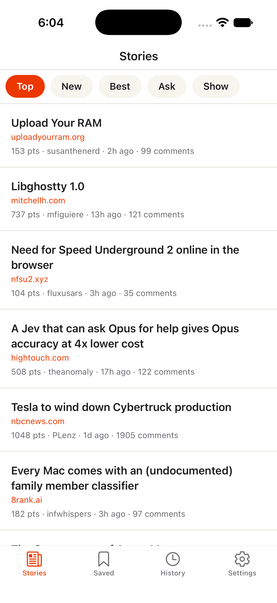
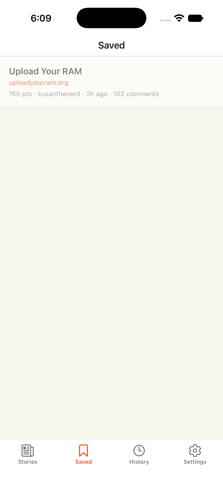
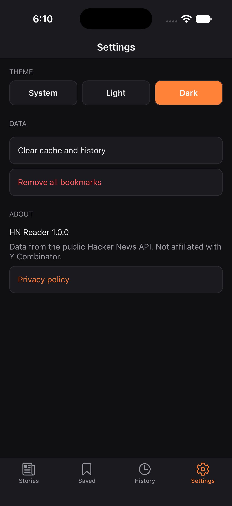
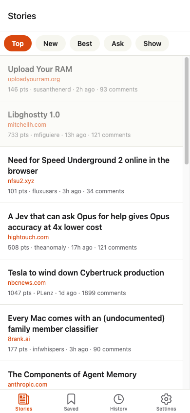
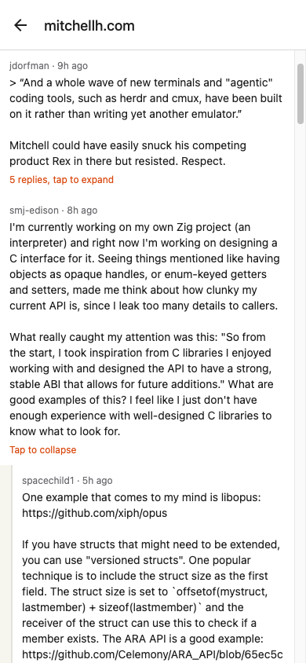
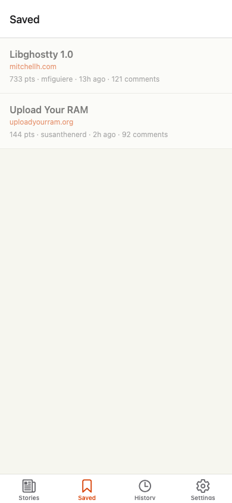
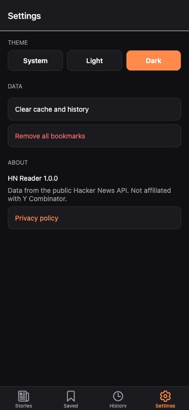

# HN Reader

**Live demo: https://informramiz.github.io/rn-showcase/** (web build of the same app, best viewed at phone width)

A Hacker News client built with React Native (Expo, SDK 58) and TypeScript. It reads the public [HN Firebase API](https://github.com/HackerNews/API), needs no API key, and works offline from cached data.

Built by Ramiz Raja as a small but complete example of production-style React Native: typed API layer, server-state caching, persisted local state, tests, CI and release config.

## Features

- Top, New, Best, Ask and Show feeds with infinite scroll (the ID list is paginated, items are fetched in batches).
- **Offline first.** Every story and comment fetched is written to a local SQLite database. When the network fails, feeds, stories and comments come from it.
- **Offline search** (Search tab) over every cached story, or only saved ones, using SQLite FTS5.
- Story detail with a nested comment tree. Replies load the first time you expand a comment, and expand and collapse with an animation.
- **Swipe actions.** Swipe a row right to save or unsave it, swipe left to hide it from the feed. On the Saved tab, swipe left to remove.
- **Notes and highlights with tags** on saved stories. They are written locally first, queued in an outbox and synced to a (fake) server with retries, backoff and conflict resolution. Each note shows its sync state, and Settings shows the queue with Sync now, Retry failed and a "flaky network" switch to demo retries.
- **Background refresh** (iOS and Android). About every 15 minutes the OS lets the app prefetch top stories and check saved stories. If a saved story has new comments, a local notification says so (opt in from Settings).
- **Deep links:** `hnreader://story/<id>` opens a story. Universal links / App Links for `https://hnreader.codebyramiz.com/story/<id>` are configured, see [Deep links](#deep-links).
- Links open in the in-app browser (`expo-web-browser`).
- Pull to refresh, loading skeletons, error state with retry, offline banner.
- Light and dark theme following the system, with an override in Settings. Settings also has clear cache and remove bookmarks.

## Screenshots

Captured on an iOS Simulator (iPhone, Expo Go): stories, story detail with an expanded comment, saved, settings in dark mode.

| Stories                                                    | Story detail                                              | Saved                                                        | Settings (dark)                                                  |
| ---------------------------------------------------------- | --------------------------------------------------------- | ------------------------------------------------------------ | ---------------------------------------------------------------- |
|  |  |  |  |

## Architecture

**Feature-based modules, MVVM with hooks:** Views → ViewModel hooks → TanStack Query → repositories (SQLite) and the offline-first HN source.

```
 View (Screen component)      renders state, forwards user events
        │  calls
        ▼
 ViewModel hook               use<Screen>ViewModel() → { state, actions }
        │  composes
        ▼
 TanStack Query hooks         one cache for remote reads (feeds, items) and local reads (bookmarks, notes, outbox)
        │
        ├──────► HnSource          network first, writes every result to the item cache, falls back to it offline
        ├──────► Repositories      ports in shared/data/ports.ts: SQLite + Drizzle on native, in-memory on web/tests
        └──────► SyncEngine        drains the notes outbox to the remote (SyncService)
```

Each screen is a plain component that calls one ViewModel hook and renders what it returns. The ViewModel owns the logic and is tested with `renderHook` and no UI. Route files in `app/` only re-export a screen, which keeps navigation separate from features.

Services are created once at startup (`createAppServices`: open the database, run migrations, import old data, build the HN source and sync engine) and handed down through `ServicesProvider`. Hooks reach them with `useServices()`, so tests swap in in-memory repositories and a fake `fetch`.

### Folder map

```
app/                          Expo Router routes: thin re-exports of feature screens, plus the two layouts
src/
  features/
    stories/                  feed screen, infinite query, hide (dismissed stories)
    story-detail/             story screen, item query, comment tree (CommentThread, flattenThread helpers)
    bookmarks/                Saved screen and bookmark hooks (repository backed)
    history/                  History screen, read ids
    search/                   Search screen (FTS5 on native)
    notes/                    notes and highlights section on story detail
    sync/                     sync status hooks, SyncBridge (refreshes queries after each sync run)
    background/               background task registration and the pure refresh logic
    settings/                 theme, sync controls, comment alerts permission flow
  shared/
    data/                     ports, HnSource, SQLite repositories + schema, memory repositories, legacy import
    sync/                     pure outbox rules, SyncEngine, fake remote
    notifications/            expo-notifications wrapper (.web.ts is a no-op)
    api/                      http client (timeout), ApiError, HN endpoints, types
    ui/                       Button, Chip, Skeleton, ErrorState, OfflineBanner, StoryList, StoryRow, SwipeableStoryRow
    query/ services/ theme/ i18n/ lib/ hooks/
drizzle/                      generated SQL migrations (drizzle-kit) and the bundled migrations.js
.maestro/                     UI smoke flow
```

Feature tests live next to their feature in `__tests__/`. Imports use the `@/` alias for `src/`. Dependencies point one way: features use `shared`, never the reverse (one exception: `shared/theme` reads the theme mode from the settings store).

### Local database

- **Schema** (`src/shared/data/sqlite/schema.ts`): `items` (every fetched HN item as JSON plus indexed columns), `feeds` (ID lists), `bookmarks` (with the comment count last seen), `history`, `dismissed`, `notes` and `outbox`.
- **Migrations** are generated with `drizzle-kit generate` into `drizzle/` and applied at startup with Drizzle's `migrate()` ([Drizzle + Expo SQLite](https://orm.drizzle.team/docs/connect-expo-sqlite)). `0001_stories_fts.sql` is a hand-written migration that adds an FTS5 external-content table over `items` with triggers to keep it in step ([SQLite FTS5](https://www.sqlite.org/fts5.html)). Search ranks with `bm25`.
- **Old data moves across once.** Bookmarks and history used to live in Zustand stores persisted to AsyncStorage. `legacyImport.ts` imports them into the database on first start and deletes the old keys only after the import succeeds, so a crash mid-way just retries.
- Local reads go through TanStack Query under `['db', ...]` keys with `staleTime: Infinity`; writes invalidate those keys. One cache, one way to read, and no second state library for data.

### Offline sync (notes)

The notes server is faked (`shared/sync/fakeRemote.ts`, optimistic concurrency with a version per note), but the client side is what a real one needs:

1. **Outbox.** Saving or deleting a note writes the note and an outbox row in one step. Repeated edits coalesce into one entry; creating and deleting a note before it ever synced cancels out.
2. **SyncEngine** (`shared/sync/syncEngine.ts`) pushes due entries with the version they were based on. It runs at startup, after every note change, and on demand. Concurrent calls share one run.
3. **Retry with backoff.** Retryable failures are rescheduled with exponential backoff and full jitter (2 s base, 5 min cap), and a timer wakes the engine for the next attempt. After 6 attempts, or on a non-retryable error, the entry is parked as failed until the user taps Retry.
4. **Conflicts.** If the server version moved on, `resolveConflict` decides: edit vs edit merges field by field (newer text wins, tags are unioned) and re-pushes only if the merge differs from the server; a local delete loses to a remote edit; a local edit re-creates a note deleted remotely.
5. **Edits during a push** are not lost: the engine compares the entry's revision before and after the request and pushes the newer edit next.

All the rules live in `outbox.ts` as pure functions with time and randomness passed in, so they are unit-tested without timers or I/O. The engine is tested against the in-memory repositories and the fake remote.

### Background refresh and notifications

`expo-background-task` registers one task (`hn-background-refresh`, minimum interval 15 minutes) ([docs](https://docs.expo.dev/versions/latest/sdk/background-task/)). The task is defined at module scope so it exists when the OS starts the app headless. It opens its own services, prefetches the top stories into the cache, and compares each saved story's comment count with the last one seen (the count is updated when you open the story). New comments become a local notification through `expo-notifications` ([docs](https://docs.expo.dev/versions/latest/sdk/notifications/)), only after the user enables alerts in Settings, which asks for permission and explains a denial. The OS decides when the task runs. On web, `backgroundTask.web.ts` and `notifications.web.ts` are no-ops.

### Gestures and animation

Rows use `ReanimatedSwipeable` from React Native Gesture Handler ([docs](https://docs.swmansion.com/react-native-gesture-handler/docs/components/reanimated_swipeable)); the action runs when the row opens past its panel, then the row closes. Comment replies use Reanimated layout animations (`FadeIn`, `FadeOut`, `LinearTransition`) ([docs](https://docs.swmansion.com/react-native-reanimated/docs/layout-animations/entering-exiting-animations)).

### Deep links

Expo Router maps `app/story/[id].tsx` to `hnreader://story/<id>` with the `scheme` in `app.json` ([docs](https://docs.expo.dev/router/reference/linking/)). The id is validated (`parseStoryId`), and a bad link shows a message instead of a request. Try it with `npx uri-scheme open hnreader://story/1 --ios`.

Universal links (iOS) and App Links (Android) are configured but not live, because they need a domain that serves the association files:

- `app.json`: `ios.associatedDomains: ["applinks:hnreader.codebyramiz.com"]`, and an Android intent filter with `autoVerify` for `https://hnreader.codebyramiz.com/story` ([iOS](https://docs.expo.dev/linking/ios-universal-links/), [Android](https://docs.expo.dev/linking/android-app-links/)).
- `public/.well-known/apple-app-site-association` and `assetlinks.json` are templates. Before going live, put in the Apple Team ID and the release signing SHA-256 and host them at the domain root.

### Other libraries

- **Expo Router**: file-based routes, typed routes, deep links.
- **FlashList**: recycled rows for long feeds.
- **Zustand**: only the theme setting, which is tiny and synchronous.
- **Jest, RNTL**: tests run without a device.

## Run

Requires Node 22+.

```bash
npm install
npx expo start        # then open in Expo Go, or press i / a for a simulator
```

## Test

```bash
npm run lint
npm run format:check
npm run typecheck
npm test -- --coverage
npm run doctor        # expo-doctor
npx expo export       # bundle sanity check
```

What is covered:

- **Pure logic:** outbox rules (coalescing, backoff, parking, conflict resolution, merge), comment flattening, story link parsing, background refresh.
- **Repositories:** one contract test suite runs against both the SQLite repositories (on a real in-memory SQLite database via `better-sqlite3` with every Drizzle migration applied, including FTS5) and the in-memory ones, so the web build behaves the same as native.
- **Sync engine** against the fake remote: backoff and timer wake-up, parking and retry, every conflict case, edits during a push.
- **ViewModel hooks** with `renderHook`, and **screens and components** (story, comment thread, notes, search, sync status, alerts permission flow, swipe rows) with React Native Testing Library. `fetch` is mocked at the boundary.

`npm test -- --coverage` currently reports about 95% lines. `jest.config.js` enforces a floor (88% statements and lines, 85% functions, 82% branches), and CI runs with coverage.

Not covered by unit tests, and checked on a device: real SQLite on the phone, the OS running the background task, notification delivery, swipe feel, and deep links. `.maestro/smoke.yaml` covers launch, scroll, open and save a story, add a note, swipe to save, the Saved tab and a deep link. Run it against an installed build with `maestro test .maestro/smoke.yaml`.

## Web demo

Web screenshots (390px wide):

| Stories                                                                                                                                                                        | Story detail                                              | Saved                                                        | Settings (dark)                                                  |
| ------------------------------------------------------------------------------------------------------------------------------------------------------------------------------ | --------------------------------------------------------- | ------------------------------------------------------------ | ---------------------------------------------------------------- |
|                                                                                                                      |  |  |  |
| `npx expo export -p web` builds a single-page app. `.github/workflows/pages.yml` deploys it to GitHub Pages under `/rn-showcase` (`experiments.baseUrl`). Known limits on web: |

- Pages has no SPA fallback, so the workflow copies `index.html` to `404.html`. Opening a deep link such as `/story/123` directly works, but the server answers HTTP 404 before the app loads.
- The database is the in-memory repository set, saved to `localStorage` through AsyncStorage, so data is per browser. Search uses token matching instead of FTS5 (see decisions).
- Background refresh and notifications are off on web (no-op modules), and swipe actions work with a mouse drag.
- Pull to refresh does not exist with a mouse. Reload the page instead.
- "Open link" opens a new browser tab instead of an in-app browser.

## Store release

The app is configured for EAS (`eas.json`, bundle id `com.codebyramiz.hnreader`). Store submission is deferred, and no builds have been made.

## Release config

`app.json` sets the bundle id and package to `com.codebyramiz.hnreader`. `eas.json` has `development`, `preview` and `production` profiles. Icon and splash in `assets/` are generated placeholders.

## Decisions and trade-offs

- **SQLite on native, an in-memory store on web.** expo-sqlite on web runs on wa-sqlite and needs OPFS with COOP/COEP headers, which GitHub Pages cannot send, and the default build has no FTS5. The repositories sit behind ports, so the web build uses a memory implementation with the same contract tests.
- **One query cache for remote and local data.** Local reads are TanStack queries with `staleTime: Infinity` that writes invalidate. The alternative, Drizzle's `useLiveQuery`, would not work for the memory store and would give screens two ways to read.
- **Last writer wins per field, tags merged.** Notes are short and personal, so a full three-way merge or CRDT is not worth it. Deleting someone's newer edit is the worst outcome, so edits beat deletes both ways.
- **Full jitter backoff** ([AWS Architecture Blog](https://aws.amazon.com/blogs/architecture/exponential-backoff-and-jitter/)) so many clients coming back online do not retry in lockstep.
- **Swipe actions fire on open, not on a panel tap.** It is one gesture instead of two, and the row closes again so the list does not keep open rows around.
- **AsyncStorage, not MMKV, for the little that is left in key-value storage** (the theme setting, and the web store). It works in Expo Go with no setup.
- **Feed tabs are chips, not bottom tabs.** Five feeds plus Saved, History and Settings is too many bottom tabs. The feeds are a chip row on the Stories screen, and the bottom bar has four tabs.
- **Comments load lazily and are collapsed by default.** Some threads have hundreds of comments. Only top-level comments load at first, replies load on expand. The tree is flattened into a row list by a pure function (`flattenThread`), which is why it is easy to test.
- **Comment text is converted to plain text.** HN comments use a small HTML subset. Links become bare URLs. Rendering real HTML would add a dependency for little gain here.
- **Refresh keeps only page one.** Pull to refresh drops the cached ID list and the extra pages, so it does not re-download everything you scrolled through.
- **Clear cache also clears history.** Bookmarks and notes are kept, and cached items of saved stories are not pruned.
- **No privacy policy link.** The app collects no data: no accounts, analytics or tracking. Bookmarks, history, notes and settings stay on the device (notes sync only to a fake server in memory). A store release would still need a hosted policy URL.
- **Local `watchman` is bypassed in the test script** (`--watchman=false`) so tests do not depend on it.
